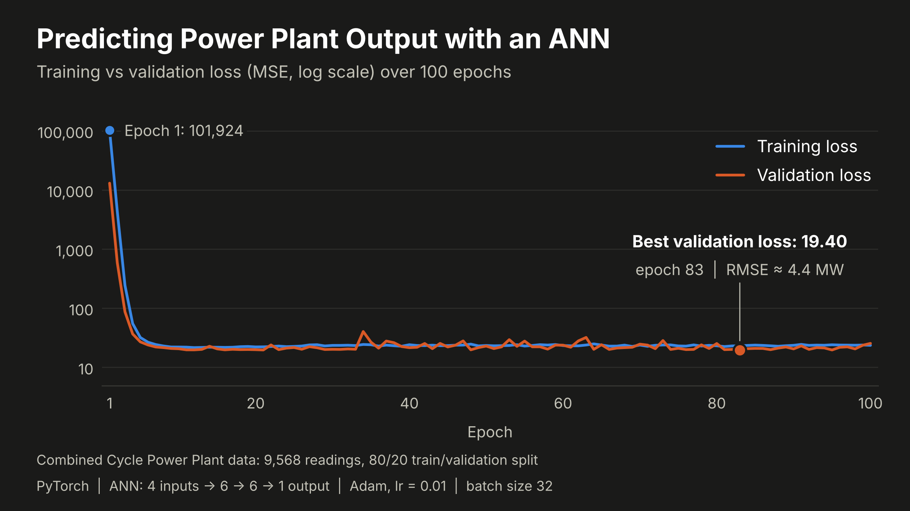

# Power Plant Output Prediction with an Artificial Neural Network

Can a small neural network predict how much electricity a power plant produces from just four measurements?

That is the question behind this project. I used the Combined Cycle Power Plant dataset, which has 9,568 rows, four input columns and one numerical target. I built the model in PyTorch while learning ANN regression, and the notebook goes through every step: preparing the data, training the network, saving the best checkpoint and checking the results.

The saved model reaches an RMSE of 4.3380 MW and an R² of 0.9342 on the held out 20 percent of the data. There is one qualification: that same 20 percent also chose the best checkpoint, so it is not a fully independent test. I explain this further down.

## The data

The CSV has five numerical columns and no missing values. Each row holds hourly average readings from the plant and the net hourly electrical output at that time.

<table>
<tr><th>Column</th><th>Meaning</th><th>Unit</th><th>Role</th></tr>
<tr><td>AT</td><td>Ambient temperature</td><td>°C</td><td>Input</td></tr>
<tr><td>V</td><td>Exhaust vacuum</td><td>cm Hg</td><td>Input</td></tr>
<tr><td>AP</td><td>Ambient pressure</td><td>millibar</td><td>Input</td></tr>
<tr><td>RH</td><td>Relative humidity</td><td>%</td><td>Input</td></tr>
<tr><td>PE</td><td>Net hourly electrical energy output</td><td>MW</td><td>Target</td></tr>
</table>

The model receives AT, V, AP and RH as `X`. The PE column becomes `y`, the number the model has to predict. PE is kept out of the inputs, otherwise the model would be handed the answer.

This is a regression problem because the answer is a continuous number, such as 450.5 MW, and not a category.

## Preparing the data

**Split first, scale after.** The data is split into 80 percent for training (7,654 rows) and 20 percent for testing (1,914 rows). `random_state=42` keeps the split the same on every run.

**Scale the inputs.** The four inputs live on very different scales. Ambient pressure is around 1,000, while temperature stays below 40. Scaling puts them on a similar footing, which makes training easier. `StandardScaler` learns the mean and standard deviation from the training data only and then applies the same numbers to both splits. If it were fitted on the whole dataset, information from the test rows would leak into the preprocessing. After scaling, the training features have a mean of about zero and a standard deviation of one, and the notebook prints this as a check.

**Leave the target as it is.** PE is not scaled, so the predictions stay in MW.

## Tensors and batches

The arrays are converted to `float32` PyTorch tensors. The inputs have four columns, and the targets are reshaped into one column to match the output of the network.

```
Training inputs:  (7654, 4)
Training targets: (7654, 1)
Testing inputs:   (1914, 4)
Testing targets:  (1914, 1)
```

`TensorDataset` keeps every input paired with its target, and `DataLoader` serves them in batches of 32 rows. The training data is shuffled every epoch, the testing data is not. One epoch has 240 training batches, so the weights are updated 240 times per epoch. The last batch is smaller (6 rows) because 7,654 is not a multiple of 32.

## The model

The network is small: two hidden layers with six neurons each, followed by one output neuron.

```
4 inputs → Linear(4, 6) → ReLU → Linear(6, 6) → ReLU → Linear(6, 1) → predicted PE
```

Each linear layer learns weights and biases. ReLU sits between the layers so that the network can learn curved relationships and not only straight lines. The output layer has no activation, because it has to return a plain number in MW.

The parameter count is small too:

```
First hidden layer:  4 × 6 + 6 = 30
Second hidden layer: 6 × 6 + 6 = 42
Output layer:        6 × 1 + 1 =  7
Total:                          79
```

The notebook defines this architecture twice. `PowerPlantANN` is the first version with the sizes typed in directly, and I used it to look at the layers. `ANN` takes the number of input features as an argument, and this is the class that is actually trained. The layers are the same in both.

I only tried this one architecture, so I cannot say that six and six neurons is the best choice for this data.

## How the model learns

Training uses mean squared error (MSE) as the loss, the Adam optimizer with a learning rate of 0.01, and 100 epochs. MSE squares the gap between each prediction and the real value and averages those squares, so big mistakes cost more than small ones.

For every batch the training loop does five things:

1. `optimizer.zero_grad()` clears the gradients from the previous update.
2. `model(xb)` sends the inputs through the network and gives predictions.
3. `criterion(outputs, yb)` measures the error.
4. `loss.backward()` calculates the gradients with PyTorch autograd.
5. `optimizer.step()` lets Adam update the weights and biases.

After every epoch the model is checked on the testing data with `model.eval()` and `torch.no_grad()`, so the loss is measured without changing anything. Whenever this validation loss is the best so far, the weights are saved to `best_model.pt` with `state_dict()`. After training, the notebook loads that file back, so the final evaluation uses the best epoch and not just the last one.

## Results

These values are copied from the saved outputs of the notebook.

<table>
<tr><th>Measurement</th><th>Value</th></tr>
<tr><td>Training MSE</td><td>20.5502 MW²</td></tr>
<tr><td>Testing MSE</td><td>18.8185 MW²</td></tr>
<tr><td>Testing RMSE</td><td>4.3380 MW</td></tr>
<tr><td>Testing R²</td><td>0.9342</td></tr>
<tr><td>Best checkpoint</td><td>epoch 94</td></tr>
<tr><td>Best validation loss</td><td>18.8132 MW²</td></tr>
</table>

RMSE is the square root of MSE, which brings the error back into MW and makes it easier to read. Here it is about 4.34 MW, while the average output in the data is about 454 MW. It does not mean that every prediction is within 4.34 MW of the real value.

An R² of 0.9342 means the model explains about 93.4 percent of the variation in PE on this split. It is not an accuracy percentage like in classification.

Training MSE and testing MSE are close, and testing is slightly lower. That is a good sign, but it is not proof that the model generalizes well, because the testing data also chose the checkpoint.

### Training and validation loss



The training loss stays between about 22 and 24.5 for all 100 epochs. The validation loss is much noisier. In 90 of the 100 epochs it sits between about 19 and 24.5, and the other ten epochs are spikes above 25, the highest being 32.66 at epoch 34. The lowest value, 18.8132, comes at epoch 94.

The validation loss is lower than the training loss in 80 of the 100 epochs. One reason is that the training loss is an average over the whole epoch while the weights are still changing, and the validation loss is measured once at the end of the epoch.

Two small details about these numbers:

* The best validation loss (18.8132) and the final testing MSE (18.8185) come from the same weights and the same data, but they are not exactly equal. The epoch loop averages the loss of every batch equally, while the final evaluation averages over all rows at once, and the last batch is smaller.
* The saved training output starts at a loss of about 23 in epoch 1. A brand new model starts far higher (above 100,000 in my first run), because PE is not scaled. So the saved log is a continuation of earlier training and not a run from scratch.

## Looking at individual predictions

An overall score can hide individual mistakes, so the notebook also puts predicted and actual values side by side. These are the first ten rows of the testing split, not hand picked:

<table>
<tr><th>Actual (MW)</th><th>Predicted (MW)</th><th>Absolute error (MW)</th></tr>
<tr><td>433.27</td><td>435.65</td><td>2.38</td></tr>
<tr><td>438.16</td><td>436.58</td><td>1.58</td></tr>
<tr><td>458.42</td><td>461.42</td><td>3.00</td></tr>
<tr><td>480.82</td><td>475.94</td><td>4.88</td></tr>
<tr><td>441.41</td><td>435.47</td><td>5.94</td></tr>
<tr><td>454.75</td><td>459.25</td><td>4.50</td></tr>
<tr><td>483.26</td><td>480.83</td><td>2.43</td></tr>
<tr><td>478.25</td><td>478.28</td><td>0.03</td></tr>
<tr><td>434.16</td><td>439.16</td><td>5.00</td></tr>
<tr><td>470.66</td><td>469.72</td><td>0.94</td></tr>
</table>

Some predictions are above the real value and some are below it. The biggest error in these ten rows is 5.94 MW. Ten rows only show what individual errors look like. The scores above are calculated on the whole testing split.

## What this evaluation can and cannot tell us

The data I call `X_test` and `y_test` is used after every epoch to pick the best checkpoint. That means the final scores describe data that influenced the choice of model, so they are probably a little optimistic. A cleaner setup uses three sets: training data to learn the weights, validation data to choose the checkpoint, and test data that is used only once at the end.

The split is fixed by `random_state=42`, but I did not set a PyTorch random seed. The starting weights and the batch order change from run to run, so a new run will give slightly different numbers.

I also did not compare the network with a simple baseline such as linear regression, so I cannot say how much the extra complexity helps.

## What I would try next

* Lower the learning rate to 0.001 and see if the validation loss becomes smoother.
* Split the data into separate training, validation and test sets.
* Scale the target PE as well.
* Compare with linear regression and with a few other architectures.
* Set random seeds so that runs can be repeated.

## Files

1. `ANN regression.ipynb` has the data preparation, the model, the training loop, the evaluation and the prediction comparison.
2. `powerplant_data.csv` is the dataset.
3. `ann_loss_curve_dark.png` is the chart shown above.
4. `README.md` is this file.

Running the training cell creates `best_model.pt`. It holds the model weights only, not the fitted scaler, so new data has to be scaled with the same `StandardScaler` before it goes into the model.

## Running it

Keep the notebook and the CSV in the same folder, and keep `ann_loss_curve_dark.png` next to `README.md` so the chart shows on GitHub.

Install the packages:

```
pip install pandas numpy torch matplotlib jupyter scikit_learn
```

In my notebook the CSV is loaded from a path on my own Windows computer. Replace that line with this one:

```python
df = pd.read_csv("powerplant_data.csv")
```

Start Jupyter from the folder that has the files:

```
jupyter notebook
```

Open the notebook and run the cells from top to bottom.

One thing to know: the training cell continues from the current weights of the model. If you run it twice, the second run starts where the first one stopped. To train from scratch again, run the cell that creates the model, the loss function and the optimizer before the training cell.

## What I learned

This project helped me connect the parts of ANN regression: separating the inputs from the target, fitting the scaler on the training data only, matching tensor shapes, building layers, computing gradients and checking predictions.

The most useful lesson was that a good score is only part of the story. How the data was split, how the best checkpoint was chosen and whether the final test stayed independent all change what a score really means.

## Credits

The dataset is the Combined Cycle Power Plant dataset by Pınar Tüfekci and Heysem Kaya, from the UCI Machine Learning Repository: https://archive.ics.uci.edu/dataset/294/combined+cycle+power+plant. It is shared under the CC BY 4.0 license. DOI: https://doi.org/10.24432/C5002N

I learned the basics of PyTorch from a tutorial by Apna College and wrote my own notes for every step.

## Author

Muhammad Zubair
